2nd-year **CSE student at RBU Nagpur**. I build projects alongside coursework, then ship them for real, fast.
Ideas in, live links out.

Showing <b>crimson</b>. Pick a colour, press <b>Submit new issue</b>, and this page recolours itself in about a minute. It returns to crimson on its own after 12 hours, or press the reset circle.

