## 🩸 about me

2nd-year **CSE student at RBU Nagpur**. I build projects alongside coursework, then ship them for real — fast.
Ideas in, live links out. Certifications on the side to keep the fundamentals sharp.

## 🔥 stack

## 🚀 projects

## 🏆 certifications

## 📊 telemetry

  

## 📡 connect

